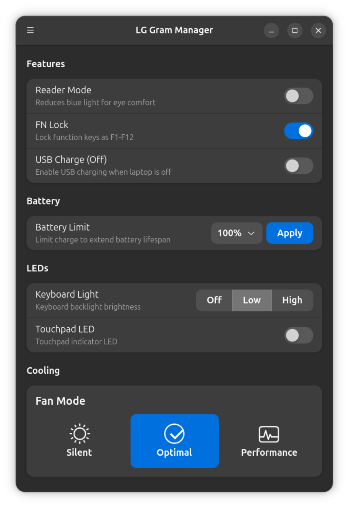

# LG Gram Manager

GTK4 application for managing LG Gram laptop features on Linux.



## Features

- Reader mode (blue light filter)
- FN lock toggle
- Fan mode (optimal, silent, performance)
- USB charging when powered off
- Battery care (80% charge limit)
- Keyboard backlight control
- Touchpad LED control

## Profiles and boot restoration (development)

The Profiles button opens a named profile editor. Each control can be left
unmanaged. Save stores the profile locally; Apply now changes hardware without
changing the boot configuration. Use at boot publishes a separate, system-owned
copy after administrator authentication. Disable boot restoration leaves current
hardware settings unchanged. Renaming or deleting a local profile does not alter
the published boot copy.

The initial Default profile uses battery 80% and Optimal fan mode, matching this
development machine's observed setup. Edit it for your preferred configuration.
The service is not enabled or started by package installation. Boot restoration
runs without a desktop session, retries for up to 30 seconds, and checks readback.
Unsupported settings are logged without blocking other settings. No direct ACPI
fallback is provided.

Remove competing root cron entries or configure other managers such as TLP not to
manage the same controls before enabling restoration. This application does not
modify those configurations. View boot results with:

```bash
journalctl -b -u lg-gram-manager-boot.service
```

The GUI and helper must both come from the updated package for profile actions.
Tests: `python3 -m unittest discover -s tests`. This first pass has no resume hook.

## Hotkeys

Settings changed with the Fn keys (keyboard backlight, fan mode, reader mode, FN lock, touchpad) are picked up by the app automatically.

The driver reports Fn-F1 (the LG control panel key) as F15. Bind F15 to `lg-gram-manager` in your desktop's keyboard settings to open the app with a key press.

## Requirements

- LG Gram laptop with the `lg-laptop` kernel module
- Linux kernel 6.2+ (kernel 6.17+ required for Performance fan mode)
- GTK4 and libadwaita
- Python 3.8+

## Installation

Packages for both Debian/Ubuntu and Arch-based distros are on the
[releases page](https://github.com/bryfur/lg-gram-manager/releases).

Debian / Ubuntu:

```bash
sudo dpkg -i lg-gram-manager_*_all.deb
```

Arch / CachyOS / EndeavourOS:

```bash
sudo pacman -U lg-gram-manager-*-any.pkg.tar.zst
sudo usermod -aG lg-gram $USER
```

During installation, your user will be added to the `lg-gram` group, which grants permission to modify laptop settings without requiring a password each time. A system restart may be required for this change to take effect.

Or run from source:

```bash
python3 lg_gram_manager_gtk.py
```

Note: Running from source without installing the package will prompt for authentication when changing settings.

## Building

```bash
./build.sh
```

The .deb package will be output to `dist/`.

## Troubleshooting

If the driver is not loaded:

```bash
sudo modprobe lg-laptop
```

To load on boot:

```bash
echo "lg-laptop" | sudo tee -a /etc/modules
```
